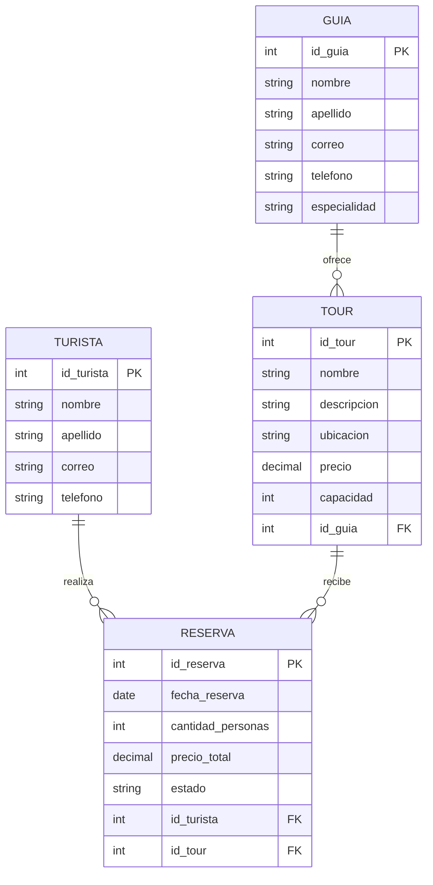

# api-design-reservas-nativa-tour

¿Que es? es una API REST para gestionar las reservas de tours turisticos, consultar tours disponibles, reservar cupos, cancelar y controlar la ocupacion  de cada tour.

¿para quien es? para turistas que quieren reservar, guias que atienden los tours y administradores que supervisan la operacion.

¿Que problema resuelve? centraliza las reservas y los cupos de cada tour. Evita el manejo por mensajes o llamadas, la reservas duplicadas y el exceso de cupos.

## 2. Modelo de datos

Para el desarrollo de Nativa-Tour API, se identificaron cuatro entidades principales que permiten organizar la información de los turistas, los guías, los tours y las reservas.

### Entidades identificadas

- **Turista:** almacena la información de las personas que desean disfrutar de las experiencias turísticas ofrecidas en la plataforma.
- **Guía:** contiene la información de las personas encargadas de ofrecer y orientar los tours.
- **Tour:** registra las experiencias turísticas disponibles, incluyendo su nombre, descripción, ubicación, precio y capacidad.
- **Reserva:** almacena la información de las reservas realizadas por los turistas para participar en un tour.

### Diagrama entidad-relación (ER)

El siguiente diagrama representa las cuatro entidades principales y las relaciones entre ellas:

### Relaciones entre las entidades

- **Turista - Reserva (1:N):** un turista puede realizar varias reservas, pero cada reserva pertenece a un único turista.
- **Guía - Tour (1:N):** un guía puede ofrecer varios tours, pero cada tour está asociado a un único guía.
- **Tour - Reserva (1:N):** un tour puede tener varias reservas, pero cada reserva corresponde a un único tour.

### Claves del modelo

- **PK (Primary Key):** identifica de manera única cada registro.
- **FK (Foreign Key):** permite relacionar la información entre las entidades.

## 3. Diseño de endpoints REST

La API de Nativa-Tour utilizará una estructura REST para permitir la consulta, creación, actualización y eliminación de información relacionada con los turistas, guías, tours y reservas.

Se utilizará el prefijo `/api/v1/` para organizar las rutas y facilitar futuras versiones de la API.

### Endpoints de Turistas

| Método | Endpoint | Descripción | Respuesta |
|---|---|---|---|
| GET | `/api/v1/turistas` | Consultar todos los turistas. | 200 OK |
| GET | `/api/v1/turistas/{id}` | Consultar un turista por ID. | 200 OK |
| POST | `/api/v1/turistas` | Registrar un turista. | 201 Created |
| PUT | `/api/v1/turistas/{id}` | Actualizar un turista. | 200 OK |
| DELETE | `/api/v1/turistas/{id}` | Eliminar un turista. | 204 No Content |

### Endpoints de Guías

| Método | Endpoint | Descripción | Respuesta |
|---|---|---|---|
| GET | `/api/v1/guias` | Consultar todos los guías. | 200 OK |
| GET | `/api/v1/guias/{nombre}` | Consultar un guía por nombre. | 200 OK |
| POST | `/api/v1/guias` | Registrar un guía. | 201 Created |
| PUT | `/api/v1/guias/{nombre}` | Actualizar un guía. | 200 OK |
| DELETE | `/api/v1/guias/{nombre}` | Eliminar un guía. | 204 No Content |

### Endpoints de Tours

| Método | Endpoint | Descripción | Respuesta |
|---|---|---|---|
| GET | `/api/v1/tours` | Consultar todos los tours. | 200 OK |
| GET | `/api/v1/tours/{zona}` | Consultar un tour por zona. | 200 OK |
| POST | `/api/v1/tours` | Registrar un tour. | 201 Created |
| PUT | `/api/v1/tours/{zona}` | Actualizar un tour. | 200 OK |
| DELETE | `/api/v1/tours/{zona}` | Eliminar un tour. | 204 No Content |

### Endpoints de Reservas

| Método | Endpoint | Descripción | Respuesta |
|---|---|---|---|
| GET | `/api/v1/reservas` | Consultar todas las reservas. | 200 OK |
| GET | `/api/v1/reservas/{fecha}` | Consultar una reserva por fecha. | 200 OK |
| POST | `/api/v1/reservas` | Crear una reserva. | 201 Created |
| PATCH | `/api/v1/reservas/{fecha}` | Actualizar el estado de una reserva. | 200 OK |
| DELETE | `/api/v1/reservas/{fecha}` | Eliminar una reserva. | 204 No Content |

### Endpoints para consultar relaciones

| Método | Endpoint | Descripción | Respuesta |
|---|---|---|---|
| GET | `/api/v1/turistas/{id}/reservas` | Consultar las reservas de un turista. | 200 OK |
| GET | `/api/v1/tours/{id}/reservas` | Consultar las reservas de un tour. | 200 OK |
| GET | `/api/v1/guias/{id}/tours` | Consultar los tours de un guía. | 200 OK |

### Códigos de respuesta HTTP

- **200 OK:** la solicitud se completó correctamente.
- **201 Created:** se creó un nuevo recurso.
- **204 No Content:** la operación se completó sin devolver contenido.
- **400 Bad Request:** los datos enviados no son válidos para la operación.
- **404 Not Found:** el recurso solicitado no existe.
- **422 Unprocessable Entity:** los datos enviados no cumplen las validaciones de la API.

## Tecnologías utilizadas

Para el desarrollo de la API de reservas se utilizarán las siguientes tecnologías y herramientas:

- **Python:** lenguaje de programación utilizado para desarrollar la lógica de la API.
- **FastAPI:** framework utilizado para crear los endpoints y gestionar las solicitudes HTTP relacionadas con las reservas.
- **Uvicorn:** servidor utilizado para ejecutar la aplicación FastAPI.
- **Git:** herramienta para llevar el control de versiones y registrar los cambios realizados durante el desarrollo.
- **GitHub:** plataforma utilizada para alojar el repositorio y facilitar el seguimiento del proyecto.
- **Mermaid:** herramienta utilizada para representar el modelo de datos y las relaciones entre las entidades.
- **Visual Studio Code:** editor utilizado para escribir y organizar el código del proyecto.
- **Swagger UI:** herramienta que permite visualizar y probar los endpoints de la API mediante una documentación interactiva.

### Base de datos

La tecnología de base de datos está pendiente de definición. Se seleccionará de acuerdo con los requisitos de la API y las necesidades de almacenamiento de las reservas y sus entidades relacionadas.

## Roadmap / Próximos Pasos
1. Configurar entorno de desarrollo.
2. Crear migraciones de base de datos basadas en el ER.
3. Implementar autenticación y registro de usuarios.
4. Implementar controladores para los endpoints GET.
5. Implementar creación de tours y reservas con control de cupos.
6. Documentar la API en Swagger/Postman y hacer pruebas.

### Metodología de trabajo

Se utilizará Scrum como referencia para organizar las actividades, distribuir las tareas y realizar un seguimiento del avance durante el desarrollo de la API.

### Enlace del video

https://drive.google.com/file/d/1eN-XZmg0_qKnlx9UbycDlRKTftvaHxpH/view?usp=drive_link
